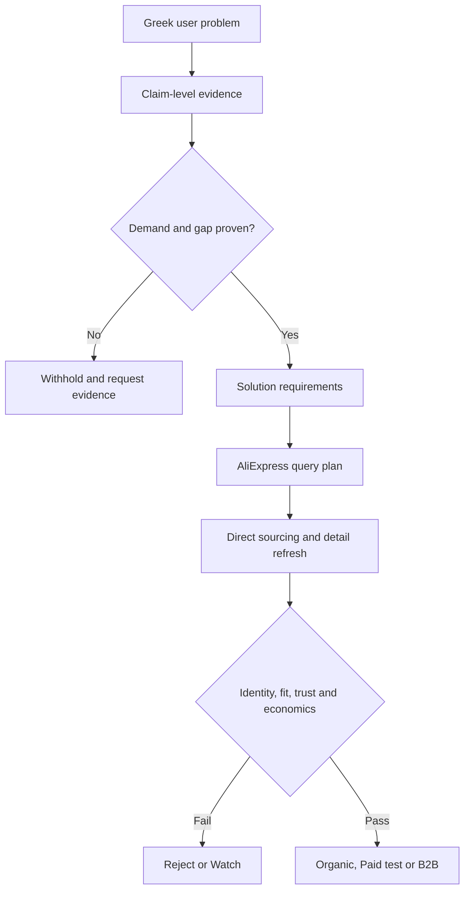

# AliExpress Gap Solver V2

## Outcome

V2 changes sourcing from “high commission product hunting” to a problem-first,
evidence-gated system:

1. collect current Greek pain, purchase-intent and supply evidence;
2. prove that demand and a meaningful market gap coexist;
3. turn the validated gap into measurable solution requirements;
4. create mechanism-diverse AliExpress queries;
5. retrieve candidates in independent relevance and sales-volume passes;
6. refresh product details and generate the AliExpress tracking URL;
7. assign one deterministic commercial lane.

The V2 path is AliExpress-only. It never reads or promotes a Linkwise offer.
The existing Linkwise tables and workers are not deleted; they remain outside
this pipeline for a later decision.

## Decision flow



The LLM can label evidence, summarize a thesis and propose queries. It cannot
set a numeric score, bypass a hard gate, invent a missing value or promote a
product.

## Evidence contract

Every stored claim records:

- source family, domain, URL and an independence key;
- observed date and expiry date;
- evidence tier: `structured_metric`, `full_text`, `snippet` or `metadata`;
- provenance class: `observed`, `user_provided`, `calculated`, `inferred` or
  `unavailable`;
- claim type, polarity, strength, confidence and the raw bounded excerpt;
- a content hash for idempotent deduplication.

Search snippets are weak discovery evidence. A snippet cannot independently
prove customer pain or buyer intent. Catalogue presence is not customer pain,
and social attention is not sales.

The harvester fetches full text only from explicitly allowlisted public
domains. Each redirect must remain on the same allowlisted root domain;
non-HTML and oversized responses are rejected.

## Problem/gap gates

A problem can produce AliExpress queries only when all gates pass:

| Gate | Default |
|---|---:|
| Fresh evidence items | at least 8 |
| Independent source families | at least 2 |
| Audited competitors/solutions | at least 3 |
| Full-text customer pain proof | required |
| Full-text buyer intent or structured first-party proof | required |
| Positive gap/availability/price-friction proof | required |
| Demand score | at least 65/100 |
| Gap score | at least 70/100 |
| Evidence quality score | at least 65/100 |
| Contradiction ratio | at most 35% |
| Confidence | at least 0.60 |

A strong gap requires a score of at least 85, at least eight evidence items and
at least three audited competitors. Evidence concentration, contradictions and
staleness reduce or withhold the result.

## Product hard gates

Before ranking, the product must have a coherent AliExpress identity, source
product ID, title, product URL, image, EUR price, traceable commission rule,
fresh observation and AliExpress promotion URL. The worker recomputes expected
commission and rejects material disagreement with the stored value.

Problem fit is calculated only from AliExpress source facts and measurable gap
requirements. Search-query similarity alone does not prove that the product
solves the problem.

## Commercial lanes

| Lane | Meaning |
|---|---|
| `REJECT` | Broken identity, non-AliExpress source, stale data, invalid economics or commission below the discovery floor. |
| `WATCH` | Commercial identity is usable, but the problem or product evidence is not yet strong enough. |
| `ORGANIC_TEST` | Validated problem solver with sufficient evidence, trust and expected commission of at least EUR 15. |
| `PAID_TEST` | Strong gap, demand at least 72, fit at least 80, trust at least 68, evidence at least 75 and commission above the dynamic paid floor. |
| `B2B_SEARCH` | Technically valid industrial/diagnostic product routed to search-led B2B demand, not consumer TikTok promotion. |

`PAID_TEST` means a bounded experiment, not scale readiness. Scaling needs
observed first-party CPC, conversion rate, approval/reversal rate and creative
cost. Policy assumptions are stored explicitly as assumptions.

### Dynamic paid commission floor

```text
paid cost per approved order = CPC / click-to-order CVR / approval rate

required commission = max(
  EUR 35,
  (paid cost per approved order + creative cost per approved order)
  / (1 - target margin rate)
)
```

With the initial policy assumptions—EUR 0.35 CPC, 1.5% click-to-order CVR, 80%
approval, EUR 5 creative allocation and 25% target margin—the paid test floor
is EUR 45.56. This is a modeled planning threshold, not observed performance.

## Database objects

Migration `20261006120000_vmdb_021_aliexpress_gap_solver_v2.sql` adds:

- `ai_gap_solver_policies`
- `ai_gap_solver_runs`
- `ai_gap_solver_evidence`
- `ai_gap_solver_problem_assessments`
- `ai_gap_solver_queries`
- `ai_gap_solver_discoveries`
- `ai_gap_solver_product_assessments`
- `ai_gap_solver_candidate_inputs_v`
- `ai_gap_solver_ready_candidates_v`
- `vmdb_aliexpress_gap_solver_health()`

All tables have RLS enabled. `anon` and `authenticated` receive no access;
only `service_role` receives the explicit backend grants.

## Runtime

Evidence collection:

```bash
python workers/demand_intelligence/deep_demand_gap_harvester_v2.py \
  --topics 8 \
  --model-calls 4
```

Safe assessment with no writes and no AliExpress requests:

```bash
python workers/agentic_backend/aliexpress_gap_solver_v2.py \
  --mode dry_run \
  --stage assess \
  --topics 8
```

Bounded live pipeline after migration and gateway rollout:

```bash
python workers/agentic_backend/aliexpress_gap_solver_v2.py \
  --mode live \
  --stage all \
  --topics 8 \
  --query-limit 32 \
  --pages 2 \
  --candidate-limit 500
```

The default workflow budgets four evidence-labeling calls and four query-plan
calls: at most eight included-quota semantic calls for the scoped run. All
candidate arithmetic and lane decisions remain local and deterministic.

The manual GitHub workflow is `.github/workflows/aliexpress-gap-solver-v2.yml`.
It defaults to `live_run: false`. It has no schedule until the bounded live run
has been reviewed.

## Rollout boundary

This implementation does not apply the migration, deploy the Edge Function,
disable V1 schedules or start a production run automatically. Recommended
rollout:

1. review and merge the V2 code;
2. apply migration 021;
3. deploy `aliexpress-affiliate-gateway` version `3.1-gap-solver-ready`;
4. run the workflow in dry mode;
5. run a live canary with 2 problem clusters, 4 queries and 1 page;
6. inspect `vmdb_aliexpress_gap_solver_health()` and Supabase security/performance
   advisors;
7. only after the canary is accepted, retire the scheduled V1 path and add a V2
   schedule.

## Tests

```bash
PYTHONPATH=workers/agentic_backend \
  python -m unittest -v workers/agentic_backend/test_gap_solver_scoring.py

PYTHONPATH=workers/demand_intelligence \
  python -m unittest -v workers/demand_intelligence/test_deep_demand_gap_harvester_v2.py
```

The tests cover evidence triangulation, stale and contradictory evidence,
snippet limitations, dynamic paid economics, Linkwise exclusion, missing
tracking URLs, organic/paid/B2B routing and fetch/redirect safety.
